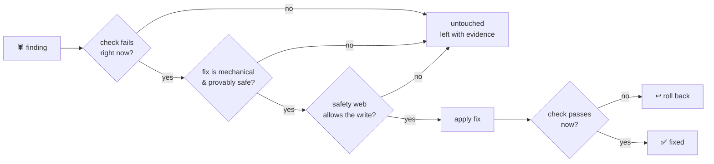
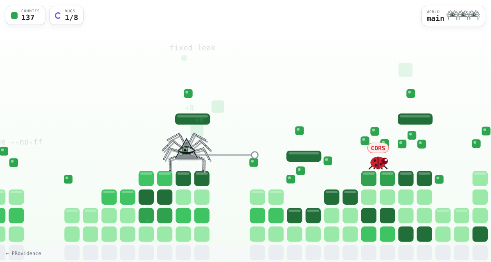

<div align="center">



<br>

[](https://spikecalls.github.io/PRovidence/quest/)
[](https://spikecalls.github.io/PRovidence/)


-39d353?style=flat-square&labelColor=0d1117)


### I gave a spider access to my GitHub and woke up to a morning report.

**[Meet it](#-meet-providence)** · **[60-second start](#-60-second-start)** · **[The one rule](#-the-one-rule)** · **[Second brain](#-the-second-brain)** · **[Safety web](#%EF%B8%8F-the-safety-web)** · **[Wardrobe](#-the-wardrobe)** · **[The game](#-providence-quest)** · **[Guide](GUIDE.md)**

</div>


## 🕷 Meet PRovidence


It crawls into the repo at **1:07 AM**, while you're dreaming about vacation.

It reads every file without blinking once. It has **8 legs** and **1 eye that never closes**.

Four legs write the code. The other four farm its **second brain**.

It has one rule I didn't expect to love:

> **It's not allowed to touch anything it hasn't reproduced first.**

It turns every bug into a **typed record**, fixes only what it can prove, leaves the rest **with evidence**, and waits for your approval like it's scared of you.

The last thing it writes in every morning report is a question to itself:

> ### *"What did I not see?"*

That one line made it better than half the engineers I've worked with.

<br clear="right">




## ⚡ 60-second start

```bash
# no install, no deps: let it crawl the repo you're in
npx github:SpikeCalls/PRovidence night

# or keep it around
npm i -g github:SpikeCalls/PRovidence
providence night ~/code/my-repo
```

What a night looks like (example run on a Rust repo):

```text
         ▄███▄
      ▀▀▀▀▀▀▀▀▄▄
  ╲  ╲     ▲     ╱  ╱
   ╲__╲   ╱ ╲   ╱__╱
 ──────  ╱[◉]╲  ──────
  ╱‾‾╱  ╱_PR__╲  ╲‾‾╲
 ╱  ╱               ╲  ╲

  PRovidence v1.3.37 · 8 legs · 1 eye that never closes

[01:07:12] eye.open() → night mode engaged
[01:07:12] crawl  4,812 files · 312,044 lines · 214 dirs
[01:07:12] langs  Rust 68.4% · C 7.2% · Shell 4.4%
[01:07:13] hunt   23 findings · 9 reproduced · 14 evidence-only
           ● 3f9a1c2e GitHub token committed to the repo  config/dev.ts:4
           ● 8b10d7a4 Unresolved merge conflict           src/sched/queue.rs:88
           ● c41e22b9 npm script "start" runs a file that does not exist  package.json:6
[01:07:13] fix    9 fixed · 0 rolled back · 0 not reproduced → untouched
[01:07:13] brain  142 notes · 336 links
[01:07:13] report .providence/MORNING.md

  What did I not see?
  · 38 path(s) skipped: binary
  · only surface checks for Rust (68.4%), C (7.2%)
  · 14 finding(s) I could smell but not reproduce
  · I did not run your test suite. Green here ≠ green in CI.
```

| command | what the spider does |
|---|---|
| `providence night [dir]` | the full shift: **crawl → hunt → fix → brain → morning report** |
| `providence crawl [dir]` | maps the repo before touching anything. writes nothing. |
| `providence hunt [dir]` | every bug becomes a typed record in `.providence/findings.json` |
| `providence fix [dir]` | reproduce → fix → reproduce again. **dry run** unless `--apply` |
| `providence brain [dir]` | farms the second brain: an Obsidian-ready vault + `graph.json` |
| `providence rules` | prints the safety web |
| `providence hats [name]` | the wardrobe 🎩 |

Flags: `--apply` (let it weave), `--ci` (exit 1 on a critical finding), `--json`, `--hat crown`.


## 🧪 The one rule

**Reproduce first. Then fix. Then reproduce again.**



Every bug becomes a **typed record**. Then a cocoon.

```jsonc
{
  "id": "3f9a1c2e",                 // stable: same bug → same id every night
  "kind": "leaked-secret",
  "title": "GitHub token committed to the repo",
  "severity": "critical",           // critical · high · medium · low
  "confidence": 0.9,
  "file": "config/dev.ts",
  "line": 4,
  "evidence": "GitHub token: ghp_…******Xz",   // secrets are redacted, always
  "blast_radius": ["config/dev.ts"],
  "fix_plan": ["revoke the credential first", "move it to a secret store", "purge from history (operator only)"],
  "fixable": false,                 // only mechanical, provably-safe fixes are true
  "status": "reproduced"            // reproduced · evidence · fixed
}
```

### The hunters

| hunter | catches | reproduced by | auto-fix |
|---|---|---|---|
| `leaked-secret` | GitHub / AWS / Slack / OpenAI keys, private keys | regex on the file, now | ❌ never: revoke first |
| `conflict-marker` | `<<<<<<<` left in a file | line scan | ❌ a human picks the side |
| `invalid-json` | JSON that doesn't parse | `JSON.parse` | ❌ |
| `missing-script-target` | `npm run start` → `node server.js` that doesn't exist | `fs.exists` | ❌ |
| `broken-link` | Markdown links to files that moved | `fs.exists` | ❌ |
| `debugger-left` | `debugger;` shipped | line scan | ❌ |
| `swallowed-error` | `catch (e) {}` | (evidence only) | ❌ |
| `note-left` | TODO / FIXME / HACK comments | (evidence only) | ❌ |
| `trailing-whitespace` | the classic | line scan | ✅ |
| `missing-final-newline` | `\ No newline at end of file` | byte check | ✅ |

> Want a new one? Open a [🕷 New hunter](.github/ISSUE_TEMPLATE/new-hunter.md) issue. Rule: **if it can't be reproduced deterministically, it can only ever be `evidence`.**


## 🧠 The second brain

Four legs code. The other four farm.

`providence brain` turns every crawl into a linked vault: **finding → file → module → PRovidence**. Open `.providence/brain/` in Obsidian and press graph view.

```text
.providence/
├── MORNING.md          ← the one-minute summary
├── findings.json       ← every typed record
├── map.json            ← the repo map
└── brain/
    ├── PRovidence.md   ← hub note
    ├── graph.json      ← nodes + links, drop into any graph viewer
    ├── modules/        ← one note per top-level module
    ├── files/          ← one note per file with findings
    └── findings/       ← one note per bug (YAML front-matter = the typed record)
```


## 🕸️ The safety web

Hard limits it can **never** override. Not a prompt. A `throw`.



| limit | how it's enforced ([`src/safety.js`](src/safety.js)) |
|---|---|
| never push to main | there is no push code at all, and `--apply` refuses on `main/master/trunk/production/release` |
| never touch secrets | writes to `.env`, `*.pem`, `*.key`, `id_rsa`, `credentials`, `.npmrc` throw `SafetyWebError` |
| never delete | the only write primitive is "rewrite file contents" |
| never rewrite history | no git write commands exist in the codebase |
| reproduce before fix | `fix()` calls `reproduce()` first; no repro = no touch |
| reproduce after fix | still failing → the original file is restored |
| operator approval | dry run by default; `--apply` *is* your approval |


## 🎩 The wardrobe

A hat for every leg, plus one spare, printed as a sheet of stamps. GitHub-only merch: try them on in your terminal with `providence hat crown` or `providence night --hat wizard`.



| | | |
|---|---|---|
| 🧢 `cap`: **Night-Shift Cap**, backwards, obviously | 🧶 `beanie`: **Hacker Beanie**, 3 AM warmth | 👑 `crown`: **Merge King**, zero regrets |
| 🧙 `wizard`: **Regex Wizard**, speaks `/.*/` | 🎧 `headphones`: **Lo-Fi Mode**, beats to refactor to | ⛑️ `hardhat`: **Prod Safety Helmet**, never pushes to main |
| 🥳 `party`: **Ship-It Party Hat**, all checks green | 🎩 `tophat`: **The Maintainer**, reviews with a monocle | 🎓 `grad`: **PhD in Bug Hunting**, thesis: "reproduce first" |

Every image in this README is generated from code: [`src/art.js`](src/art.js) → `npm run art`. Want a new hat? [Open an issue](.github/ISSUE_TEMPLATE/new-hat.md).


## 🎮 PRovidence Quest

> I opened my laptop and found a game called **PRovidence Quest**.
> I'm the side character in my own repo now.

<a href="https://spikecalls.github.io/PRovidence/quest/"></a>

- **The level is your contribution graph.** Type your username: every week is a column, every green square is a platform, and every empty week is a pit.
- **Commits are coins.** Your real contribution counts.
- **The enemies are bugs you wrote:** `off-by-1`, `null`, `CORS`, `flaky`, `typo`, `race`, `NaN`, `leak`. Wrap them in silk or stomp them.
- **The final boss is a merge conflict.** Eight hunks. Wrap every one in silk until it merges.

`←` `→` crawl · `Space` jump · `X` shoot silk · touch controls on mobile.

**[▶ Play it](https://spikecalls.github.io/PRovidence/quest/)** · share your run: `…/quest/?user=<your-github-name>`


## 🌙 Let it watch your repo every night

```yaml
# .github/workflows/night-shift.yml
name: night-shift
on:
  schedule: [{ cron: '7 1 * * *' }]   # 01:07, while you're dreaming
  workflow_dispatch:
permissions:
  contents: read                       # it reads. it never pushes.
jobs:
  night:
    runs-on: ubuntu-latest
    steps:
      - uses: actions/checkout@v4
      - uses: SpikeCalls/PRovidence@main
        with:
          fail-on-critical: true       # red ✗ if a secret or conflict marker is left
```

The morning report lands in the job summary. Full walkthrough → **[GUIDE.md](GUIDE.md)**.


## 👁 What did I not see?

PRovidence ends every report with this, so here's the README's version:

- It reads **text, not intent**. "Correct code doing the wrong thing" is invisible to it.
- It doesn't run your test suite. Green here ≠ green in CI.
- Deep checks are JS/TS/JSON/Markdown. Other languages get the surface checks (secrets, conflicts, whitespace, notes).
- The **1,337 commits** and **61,204 files** are from the story in the videos. Your night will have its own numbers, and they'll be real.


## 🛠 Project layout

```text
bin/providence.js   the CLI
src/crawl.js        crawl_layer: the read-only repo map
src/hunt.js         finding_schema + hunters + reproduce()
src/fix.js          fix_protocol: reproduce → fix → reproduce again
src/safety.js       safety_web: hard limits, enforced in code
src/brain.js        second_brain: Obsidian vault + graph.json
src/report.js       night_shift: the morning report
src/art.js          the spider, the window, the eye, the hats
docs/               the website + PRovidence Quest (GitHub Pages)
action.yml          use it as a GitHub Action
```

```bash
npm test          # 10 tests, node:test, zero deps
npm run art       # regenerate every SVG
npm run night     # let it crawl itself
```

<div align="center">

<br>


**Made by [Spike House](https://github.com/SpikeCalls)**

*You don't need another engineer. You need something that watches your repo at night.*

⭐ **Star it so the spider knows you're watching back.**

</div>
